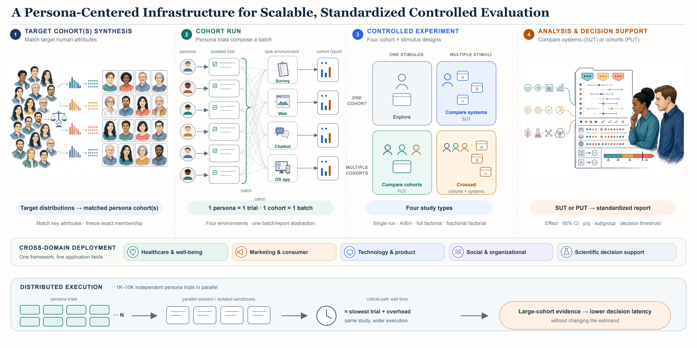
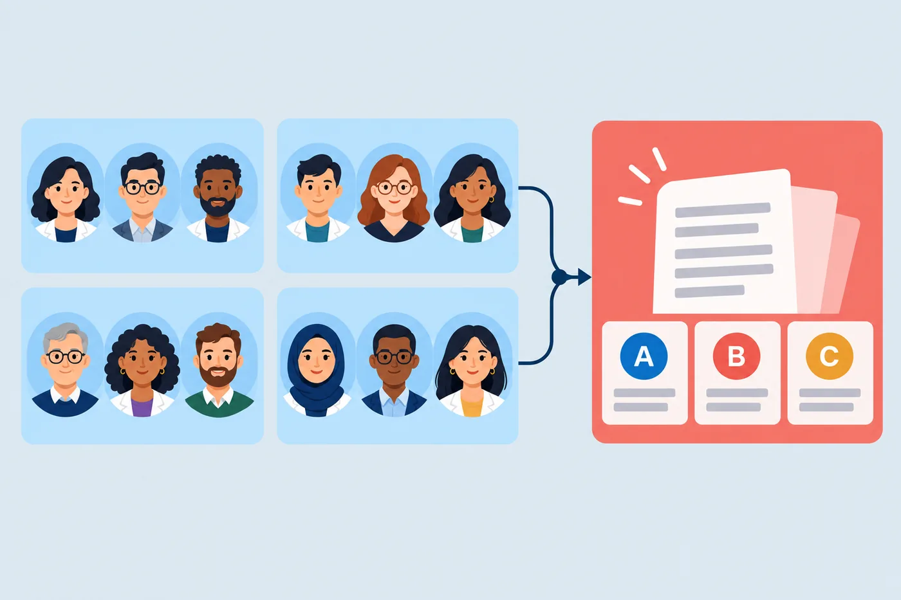
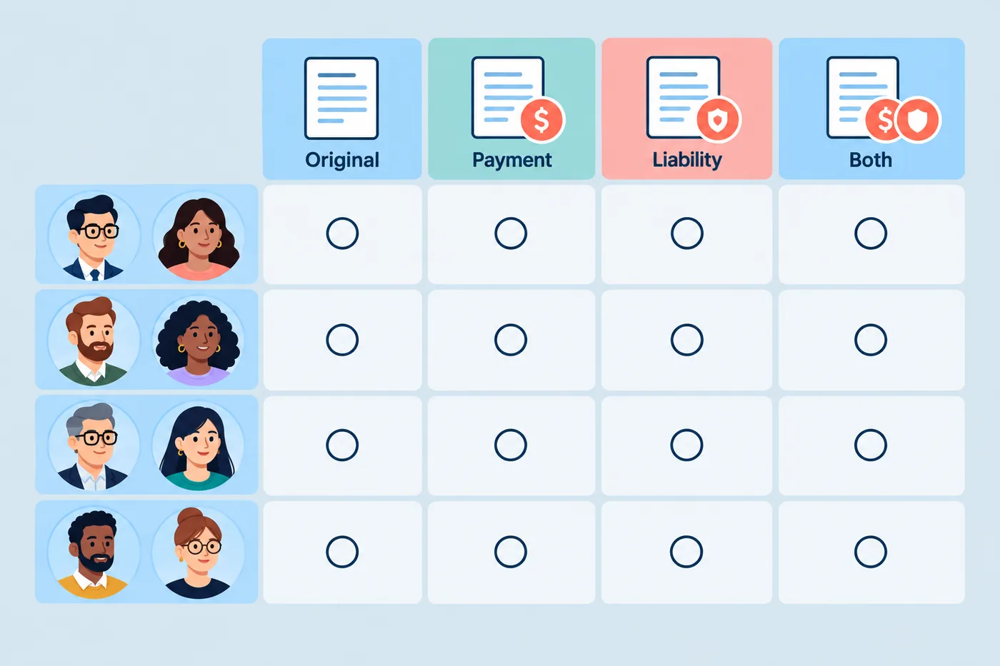

<div align="center">
  <h1>MatrAIx in the Wild</h1>
  <p><strong>Arquitectura de simulación de personas y experimentos controlados para decisiones del mundo real</strong></p>
  <p>
    <a href="../../README.md">English</a> |
    <a href="README.zh-CN.md">简体中文</a> |
    <a href="README.zh-TW.md">繁體中文</a> |
    <a href="README.ko.md">한국어</a> |
    <a href="README.ja.md">日本語</a> |
    <strong>Español</strong> |
    <a href="README.pt-BR.md">Português</a>
  </p>
  <p>
    <a href="https://matraix.ai/"></a>
    <a href="https://matraix.ai/research/matraix-in-the-wild.html"></a>
    <a href="../README.md"></a>
    <a href="https://huggingface.co/datasets/MatrAIx2026/MatrAIx_Persona_1M_Public_Release"></a>
    <a href="../../LICENSE"></a>
  </p>
</div>

Este repositorio acompaña nuestro
[informe técnico](https://matraix.ai/research/matraix-in-the-wild.html)
sobre simulación de personas para decisiones del mundo real. Convierte el
comportamiento de cohortes de personas especificadas en entornos de producto
en mediciones repetibles, y conecta en un solo pipeline la **simulación de
usuarios**, los **recorridos de producto** y los **experimentos controlados
estándar de la industria**.

La evidencia se organiza en cuatro unidades enlazadas: un *ensayo* (una
persona × un estímulo), una *ejecución en lote* (una cohorte × un estímulo
fijo), una *comparación controlada* entre cohortes o estímulos, y un
*informe estandarizado* para la decisión. Cada unidad se mapea a la de abajo,
de modo que un resultado agregado permanece trazable a sus observaciones
constituyentes y a las afirmaciones que ese nivel puede sostener.

Un estudio congela su cohorte objetivo como un manifiesto de personas
reutilizable y luego la expone a encuestas, chatbots, sitios web o apps de
sistema bajo un contrato de experimento escrito: qué cambia, qué permanece
fijo y qué métricas son primarias, secundarias o de guardarraíl. La
asignación compartida reutiliza los mismos IDs de persona entre brazos; la
asignación dividida los particiona. El mismo protocolo puede volver a
ejecutarse tras una revisión de producto o de modelo.

Las respuestas simuladas no sustituyen evidencia de personas reales. Hacen
que *quién se simula* sea una parte inspeccionable del estudio, e identifican
qué alternativas, qué diferencias entre grupos y qué preguntas abiertas
merecen una evaluación humana posterior. El esquema poblacional y el coreset
Persona 1M viven en
[MatrAIx-Persona-8B](https://github.com/MatrAIx-ai/MatrAIx-Persona-8B).

<p align="center">
  
</p>

<p align="center"><em>Cohorte → ejecución en lote → experimento controlado → informe. Cada resultado agregado vuelve a sus ensayos.</em></p>

## Qué puede preguntar

Cada estudio es **quién × qué**: una cohorte o varias, una experiencia o
varias versiones. Eso da cuatro diseños. Las figuras vienen del
[informe técnico](https://matraix.ai/research/matraix-in-the-wild.html)
(se omiten detalles). Ilustran el *tipo* de pregunta, no una tarea que haya que clonar.

<table>
  <tr>
    <th width="14%" align="center"><sub>quién ↓ · qué →</sub></th>
    <th width="43%" align="center">Una experiencia</th>
    <th width="43%" align="center">Varias versiones</th>
  </tr>
  <tr>
    <th valign="middle" align="center">Una<br>cohorte</th>
    <td valign="top" align="center">
      
      <br><strong>Explorar respuestas</strong><br>
      ¿Cómo responde este grupo a una idea o experiencia?<br>
      <em>Una ejecución en lote. Útil para fricción y colas — no es un efecto por sí sola.</em>
    </td>
    <td valign="top" align="center">
      
      <br><strong>Comparar alternativas</strong><br>
      ¿Cómo responde este grupo a distintas versiones?<br>
      <em>Las mismas personas, distinto producto / texto / página (SUT).</em>
    </td>
  </tr>
  <tr>
    <th valign="middle" align="center">Varias<br>cohortes</th>
    <td valign="top" align="center">
      
      <br><strong>Comparar grupos</strong><br>
      ¿Cómo responden distintos grupos a la misma experiencia?<br>
      <em>La experiencia queda fija; cambia quién se simula (PUT).</em>
    </td>
    <td valign="top" align="center">
      
      <br><strong>Comparar alternativas entre grupos</strong><br>
      ¿Qué versión funciona mejor para qué grupo?<br>
      <em>Varían ambos ejes.</em>
    </td>
  </tr>
</table>

El primer experimento de abajo es **Comparar alternativas**. Los ejemplos de
encuesta y web de esa celda (y de Comparar grupos) están en `experiments/tasks/`.

## Empiece aquí

Necesita [uv](https://docs.astral.sh/uv/) y Python 3.12. Node 20+ es solo para
Playground. Docker es solo para tareas web / OS-app — no para el experimento de
encuesta de abajo. En Windows use
[WSL2](https://learn.microsoft.com/windows/wsl/install) y clone dentro del
sistema de archivos de Linux (no en `/mnt/c/…`).

```bash
git clone https://github.com/MatrAIx-ai/MatrAIx_in_the_Wild.git
cd MatrAIx_in_the_Wild
uv venv --python 3.12
uv pip install -e .
uv pip install -e packages/playground
uv pip install -e packages/harbor-langsmith
uv pip install -e packages/rewardkit
```

Copie `application/playground/.env.local.example` a
`application/playground/.env.local` y añada una clave. El archivo de ejemplo
usa por defecto `anthropic/claude-haiku-4-5` (`ANTHROPIC_API_KEY`). Otros
prefijos (`ppapi/…`, `dashscope/…`, `openai/…`) están en
[agents.md](../environment/agents.md).

Confirme la instalación (sin clave):

```bash
uv run matraix smoke application/tasks/example-survey_product-feedback
```

Debería ver `Smoke: ok`. Recorrido más largo:
[quickstart](../quickstart.md).

### 1. Playground — ejecute un experimento en la interfaz

```bash
# Terminal A
VENV=.venv bash application/playground/backend/run_dev.sh

# Terminal B
cd application/playground/frontend && npm ci && npm run dev
```

Abra http://localhost:5173 → **Experiments** → **New experiment** →
[`survey-onboarding-framing`](../../experiments/tasks/survey-onboarding-framing/)
→ **Configure & Run** → elija una cohorte pequeña → **Launch 2-arm experiment**.

Las mismas personas ven un onboarding enmarcado por funciones y otro por
resultados. La satisfacción es la métrica principal; el esfuerzo percibido es
la barrera de seguridad.

### 2. CLI — el mismo experimento

```bash
uv run matraix experiment create experiments/tasks/survey-onboarding-framing \
  --name onboarding-first-run \
  --per-arm 4 \
  --seed 42
```

`--per-arm 4` es un primer pase barato (las mismas 4 personas en ambos brazos).
Usa el modelo de persona de `.env.local`. Cuando termine:

```bash
uv run matraix experiment list
uv run matraix experiment analyze <experiment_id>
```

También en `experiments/tasks/`: `survey-upgrade-copy` (A/B de texto),
`survey-trust-by-segment` (comparar grupos), `web-compare-options` (A/B web,
necesita Docker).

Para una cohorte real, importe
[Persona 1M](https://huggingface.co/datasets/MatrAIx2026/MatrAIx_Persona_1M_Public_Release):

```bash
huggingface-cli download MatrAIx2026/MatrAIx_Persona_1M_Public_Release \
  --repo-type dataset \
  --local-dir persona/datasets/matraix-persona-1m/release
```

El `matraix-persona-dev-sample` del repo (~200 personas) es solo para humo.

Para añadir su propio estudio, copie `application/tasks/example-*` o
`experiments/tasks/*` y siga la
[guía de tareas](../application/task-guide.md) o la
[guía de tareas de experimento](../application/experiment-task-guide.md).

## Qué ocurre en una ejecución

1. **Cohorte** — filtre y muestree personas, luego congele los IDs para que
   las mismas personas puedan ver una versión nueva después.
2. **Lote** — una experiencia, ensayos aislados. Las salidas quedan en
   `jobs/<job_name>/`.
3. **Experimento** — el contrato se despliega en brazos y lanza esos jobs.
   La asignación compartida reutiliza a las mismas personas entre brazos; la
   asignación dividida las reparte.
4. **Informe** — los brazos se comparan en las métricas que nombró. El informe
   conserva denominadores, exclusiones y un camino de vuelta a cada ensayo.

## Docs

| | |
|---|---|
| [Informe técnico](https://matraix.ai/research/matraix-in-the-wild.html) | Por qué existe este stack y cómo se diseñan los estudios |
| [Quickstart](../quickstart.md) | Primera ejecución, paso a paso |
| [Guía de tareas de experimento](../application/experiment-task-guide.md) | Escriba un experimento de comparar alternativas o comparar grupos |
| [Artefactos de experimento (HF)](../application/hf-experiment-artifacts.md) | Envíe una cohorte congelada y los artefactos de los ensayos (dataset privado) |
| [Agentes y claves](../environment/agents.md) | Ids de modelo y claves de API |
| [Handbook](../README.md) | Docs de persona, aplicación y entorno |

```text
application/tasks/       Tareas de ejemplo (encuesta, chat, web, OS-app)
experiments/             Experimentos controlados + scorecard
persona/                 Esquema, datasets, muestreo
environment/             Runtime, agentes, Docker / sidecars
application/playground/  Runner visual
configs/jobs/            Recetas de jobs
jobs/                    Salidas locales (gitignored)
```

## Licencia

MIT — véase [LICENSE](../../LICENSE).
